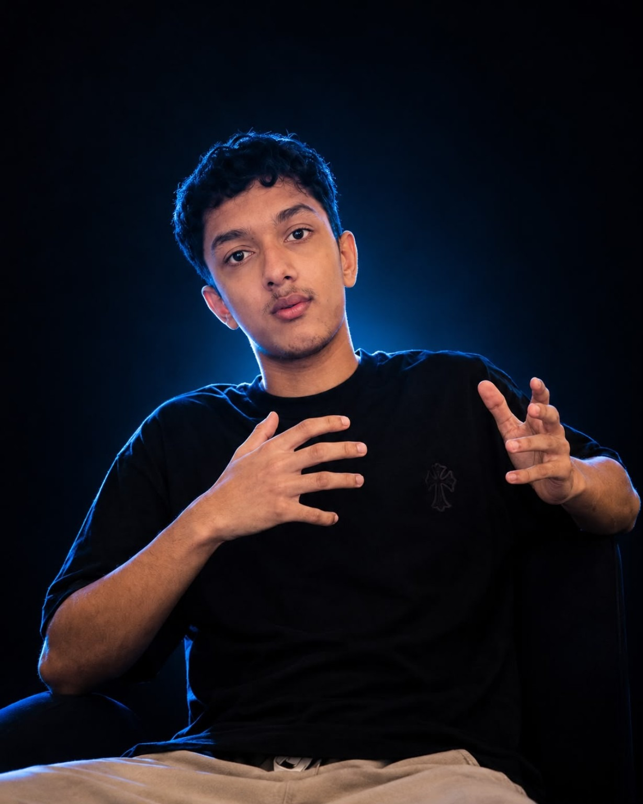

### Student Builder · Aspiring Entrepreneur · Tech Enthusiast

*Learning, building, experimenting, and creating things that matter.*

---

## 👋 About Me

I'm **Dibash Lamichhane**, a Grade 11 Science student and student-builder from Nepal.

- 🔭 Building **ROLLX** — an indoor quad-skating experience in Lalbandi, Nepal.
- 🌱 Exploring web development, Python, AI/ML fundamentals, and software development.
- 🧩 Interested in student-led technology projects, educational technology, and STEM initiatives.
- 📚 I enjoy mathematics, teaching, entrepreneurship, leadership, writing, and spirituality.
- 📫 **Email:** [dibaslamichhane04@gmail.com](mailto:dibaslamichhane04@gmail.com)

> ⚡ I have a habit of turning ideas into projects — from tech products and business concepts to STEM events, teaching, and writing about my teenage experiences.

## 📊 GitHub

*These two cards use a public image service. If they fail to load, your profile README and locally hosted visuals will still work.*

## 🚀 Featured Projects

## 🛠️ Tools & Technologies

## 🤝 Connect

**BUILD · LEARN · EXPERIMENT · REPEAT**

